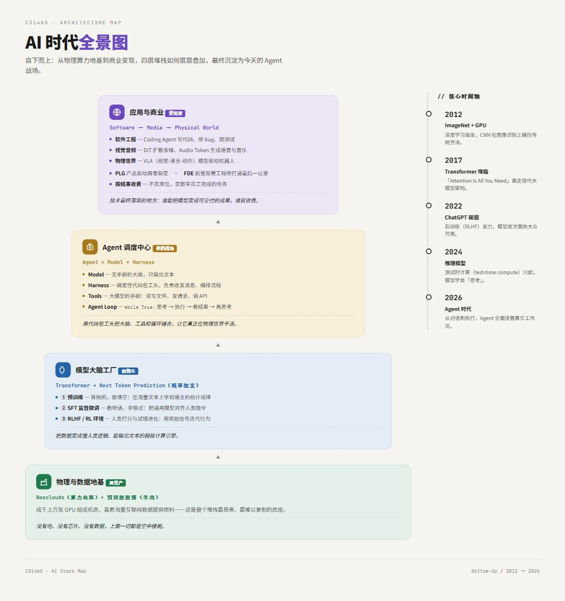
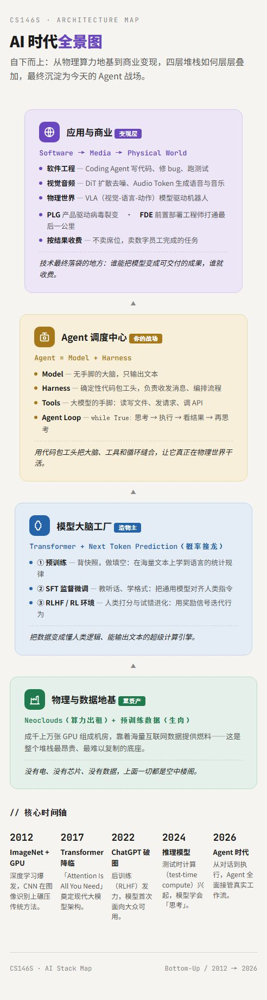

# 🚀 CS146S W0 学习日志：AI 发展全景与 Agent 时代认知地图

> **课程**：Stanford CS146S - The Modern Software Developer  
> **主题**：AI 底层原理、大模型演进史与 Agent 架构全景  
> **整理者**：[shuyuxing111]
# 视觉导图

---

## 📌 目录
- [前置知识：AI 底层基石](#前置知识ai-底层基石)
  - [1. 算力与物理基建](#1-算力与物理基建)
  - [2. 模型是如何思考的](#2-模型是如何思考的)
  - [3. Agent 是怎么动起来的](#3-agent-是怎么动起来的)
  - [4. Agent 跨领域应用原理](#4-agent-跨领域应用原理)
  - [5. 商业与生态怎么转](#5-商业与生态怎么转)
- [篇章二：四波浪潮——AI 走到今天的路标与配方](#篇章二四波浪潮ai-走到今天的路标与配方)
  - [1. 四波浪潮的演进史](#1-四波浪潮的演进史)
  - [2. 现代大模型的“完整配方”](#2-现代大模型的完整配方)
  - [3. 商业终局：垂直智能体与按结果收费](#3-商业终局垂直智能体与按结果收费)

---

## 前置知识：AI 底层基石

### 1. 算力与物理基建
**名词**：`GPU`、`Neoclouds`、`预训练数据`。

*   **GPU（图形处理器）**：由数千个较小且简单的计算核心组成（原用于游戏渲染）。
    *   *CPU*：擅长处理复杂的串行逻辑。
    *   *GPU*：可以进行大规模的并行计算。深度学习的核心是海量矩阵乘法，GPU 的并行架构完美适用于大模型训练。
*   **Neoclouds**：为 AI 公司提供顶配 GPU 算力的云服务商。高度聚焦于 AI 优化的基础设施（如极致的水冷散热、极低延迟的网络互联）。
*   **预训练数据**：用于训练基础大模型的海量、无标注原始语料，是模型进行 Next Token Prediction 的基础。

> 💡 **[总结]**：AI 并不是魔法，它是暴力美学。因为深度学习的本质是海量重复的矩阵乘法，所以需要成千上万张 GPU（小学生算加减法）并联。而把这些 GPU 集中起来建机房、卖出租时费的公司，就是 Neoclouds。

---

### 2. 模型是如何思考的
**名词**：`Token`、`Self-Attention`、`Next Token Prediction`、预训练与后训练（`SFT`、`RLHF`、`RL环境`）。

*   **Token（词元）**：大模型处理文本的最小单位。通过分词器（Tokenizer）将文本切分 -> Token，再将其映射为高维向量（Embedding）进行计算。
*   **Self-Attention（自注意力机制）**：Transformer 架构的核心组件。通过计算序列中每个词与其他所有词的关联权重（通过 Query、Key、Value 向量进行点积运算），让模型能够动态地理解上下文关系，解决长距离依赖问题。
*   **Next Token Prediction（下一词元预测）**：LLM 最底层的训练和推理目标。
    *   *How*：通过前 N 个 Token（已知上下文）计算词表中每个词作为下一个 Token 出现的概率，并输出概率最高的词。这种自回归（Autoregressive）方式实现了连贯的文本输出。
*   **预训练（Pre-training）**：海量网络数据“拍快照”，喂给模型做填空题。
*   **后训练（Post-training）**：
    *   **SFT（监督微调）**：使用人工标注的高质量“问答对（Prompt-Response）”数据对模型微调，让模型学会“听懂指令”并遵循特定的输出格式。
    *   **RLHF（基于人类反馈的强化学习）**：先让模型生成多个回答，由人类标注员进行偏好排序打分。利用这些数据训练一个“奖励模型（Reward Model）”，最后用强化学习算法让模型根据打分优化自身行为。
    *   **RL 环境**：强化学习中 Agent 所处的外部系统。Agent 执行动作（Action），环境返回状态（State）和奖励（Reward）信号。可以是代码沙盒（数字环境），也可以是机械臂（物理环境）。

> 💡 **[总结]**：大模型的本质是一个概率接龙机器。预训练让它在海量数据中学会了人类语言的规律；后训练（SFT 和 RL 环境）则负责用标准答案和试错惩罚来训练它听话、聪明。

---

### 3. Agent 是怎么动起来的
**名词**：`Model`、`Harness`、`Tools`、`Agent Loop`。

*   **Model（大模型）**：一个参数极其庞大的神经网络（Transformer 架构），具备理解自然语言、逻辑推理和生成代码的能力。但它是【无状态、无物理执行能力的纯计算引擎】。
*   **Harness（脚手架/调度框架）**：包裹在大模型外部的确定性代码系统。负责处理 I/O 交互、组装上下文（Context Engineering）、解析模型输出、执行本地工具，并控制主循环。它是将模型的“非确定性推理”转化为“确定性执行”的工程外壳。
*   **Tools（工具）**：Harness 暴露给大模型调用的外部函数接口（API），包含名称、描述（Docstring）和输入参数（Schema）。大模型决定何时调用，但真正的执行由 Harness 在本地完成。
*   **Agent Loop（智能体循环）**：
    *   1. 将用户输入、历史记录和工具执行结果打包发给模型。
    *   2. 解析模型响应：如果有工具调用请求（Tool Calls），则执行工具并将结果回传。
    *   3. 重复此过程，直到模型返回最终文本或触发终止条件。

> 💡 **[总结]**：大模型是没有手脚的大脑，被关在盒子里。而我们写的 Harness 给了它眼睛和手脚。通过 while 循环，大模型指挥 Harness 去调用各种工具，直到任务完成。**`Agent = Model + Harness`**。

---

### 4. Agent 跨领域应用原理
*   **软件工程领域（Coding Agent）**：通过 Harness 赋予大模型读写本地文件和执行终端命令的能力。利用 Agent Loop，让模型在真实的代码库中自主试错、查阅文档、修改代码并运行测试，直到任务完成。
*   **视觉与内容生成领域（DiT 与多模态）**：将扩散模型（Diffusion）与 Transformer 架构结合（DiT）。文本大模型负责解析意图，图像/视频模型通过“去噪”从纯随机噪声中一步步还原出高保真画面。Agent 可调度这些模型自动完成流水线生产。
*   **音频与声波领域（Audio Transformer 与 TTS）**：利用 Transformer 架构进行音频生成。模型将连续的声波信号离散化压缩为 Audio Tokens（音频词元），采用类似大语言模型的预测机制，结合声纹特征和情绪控制，最终通过神经音频编解码器还原为高保真声波。
*   **物理世界领域（VLA）**：VLA 模型将视觉感知（Vision）、自然语言指令（Language）和物理动作控制（Action）统一到 Transformer 架构中。接收摄像头画面和语音指令，直接输出机械臂的坐标和关节转动角度，实现具身智能。

---

### 5. 商业与生态怎么转
**名词**：`四层架构`、`数据飞轮`、`PLG`、`Agentic AI SaaS`、`FDE`。

*   **四层架构（底层商业版图）**：
    *   底层算力与数据商（如 Nvidia、CoreWeave）
    *   -> 模型创造层（如 OpenAI、DeepSeek）
    *   -> 推理分发层（如云厂商 API）
    *   -> 产品应用层（如 Cursor、Claude Code）
*   **数据飞轮（Data Flywheel）**：一种正向循环的商业与技术机制。海量用户使用产品产生交互数据 -> 数据被用于微调或强化学习 -> 模型变强 -> 产品体验更好 -> 吸引更多用户。
*   **PLG（Product-Led Growth，产品驱动增长）**：不依赖庞大的销售团队，而是通过提供免费额度（Freemium），让用户直接体验核心价值，靠产品自身传播力实现病毒式裂变。
*   **Agentic AI SaaS & FDE**：Agentic AI SaaS 指软件从“提供工具”演变为“提供自主完成任务的数字员工”。FDE（前置部署工程师）负责深入客户现场，将 Agent 与客户复杂的本地遗留系统打通，完成最后一公里的工程落地。

> 💡 **[总结]**：AI 产业链从上到下分为应用层、服务层、模型层、算力层。我们作为开发者，战场在应用层（造 Harness）。而用户的每一次纠错，都会形成“数据飞轮”，反哺底层模型的进化。

---
---

## 篇章二：四波浪潮——AI 走到今天的路标与配方

### 1. 四波浪潮的演进史
*   **1950s - 1990s（漫长潜伏）**：神经网络与深度学习的底层技术在 50 年代就已被提出，到 90 年代技术已相当成熟，但受限于算力和数据，迟迟没有真正起飞。
*   **2009 - 2010（备好燃料）**：李飞飞在斯坦福创建了 **ImageNet** 数据集（约百万张标注图像），为后续的大规模训练准备好了必不可少的“燃料”。
*   **2012 - 2016（第一波浪潮：深度学习爆发）**：新初始化方法 + 游戏 GPU 算力 + ImageNet 数据，三者历史性交汇。图像、语音、翻译等任务准确率一举提升 10%~15%，AI 正式进入大众视野。
*   **2017（第二波浪潮：Transformer 降临）**：Google 发布神级论文《Attention Is All You Need》，**Transformer 架构**与**下一词元预测**登场。它成为至今为止每一个现代大语言模型的通用骨干架构。
*   **2022（第三波浪潮：ChatGPT 破圈）**：ChatGPT 将**后训练与 RLHF** 装进了一个极简的聊天界面，大语言模型第一次以“懂人类、会听话”的形态走进普通人的日常。
*   **2024（第四波浪潮：推理模型与智能体起源）**：OpenAI 的 o1 开启了推理模型时代。**测试时计算（Test-time Compute）** 让模型“多想一会儿”就能解更难的题，智能体（Agent）由此起源。
*   **2026（现代模型配方成型）**：预训练、监督微调、对齐、推理强化学习层层叠加，从底层的张量计算，一路拼接到能自主调用工具与技能的智能体。

### 2. 现代大模型的“完整配方”
预训练只会补全句子，后训练才让模型学会听话。这两步结合，才拼出了今天能当打工人的智能体：

*   **预训练（基础底色）**：简单补全句子，连任务都算不上，只是学到了世界知识的统计规律。
*   **第一步：监督微调（SFT）**：
    *   *原理*：拿一堆你想学习的输入输出对（X Y 样本对），让模型学会模仿输出应该是什么样。
    *   *意义*：开始贴合我们关心的任务，让模型学会“听懂人话”。
*   **第二步：对齐（RLHF）**：让人类介入打分，确保模型的价值观和输出符合人类偏好。
*   **第三步：推理强化学习（RL）**：配合**测试时计算（Test-time Compute）**，也就是推理时投入更多算力让模型思考，让它学会复杂的逻辑推理。

### 3. 商业终局：垂直智能体与按结果收费
当 Agent 技术成熟，软件行业的商业规则正在被彻底重写：

*   **垂直 AI 的打法**：高度一致。先搭一个平台，去捕捉特定领域的工作流；把这些工作流观察透彻后，**固化（沉淀）** 下来，变成一个可复用的垂直智能体。
*   **商业模式的颠覆（按结果定价 vs 按席位收费）**：
    *   **席位（传统 SaaS）**：按人头订阅收费（比如公司有 100 个销售，买 100 个账号）。
    *   **按结果定价（Agentic AI）**：不按席位收费，也不按 token 收费。**只按你完成了向用户承诺的任务来收费**（比如客服 Agent 每解决一个客诉收 5 毛钱）。
    *   *代表公司*：像 Decky 和 Sierra 这样的垂直领域公司，已经全面采用按结果定价。软件正在彻底商品化。
